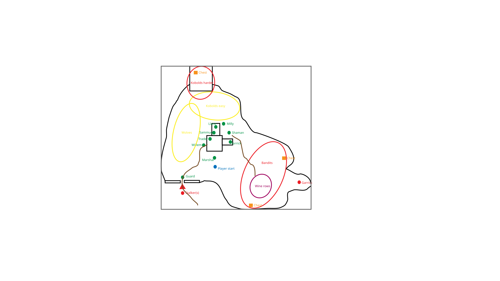

# Reduced valley and sprite plan

Layout guidance for the valley and the owner’s art work. Keep Northshire recognizable
through the abbey, wolf woods, mine, vineyard and gate. Aim for a few encounters
with clear silhouettes and space to maneuver. Enemy counts and pacing await play.

## Valley sketch

Use the owner’s [map sketch](map.svg) as the layout reference, replacing the earlier
text map. The game map now connects the abbey, western wolf woods,
northern camp and mine, southeastern vineyard, eastern ridge and southwestern gate.

The sketch places wolves west of the abbey, easier kobolds to the north and harder
kobolds farther north in the mine. Bandits occupy the southeastern vineyard, with
Garrick at the eastern end. The player starts south of the marshal; the guard stands
at the southwestern gate, with stalkers approaching from outside. Three marked chests
provide exploration destinations. Use the sketch for approximate relative distances,
then adjust routes and encounters through play.

Use the nine friendly contacts shown: marshal, Willem, Milly, guard, Llane, Jorrick,
Sammuel, shaman and trader. Give each a distinctive prop and outline. The shaman’s
name/story and the trader’s exact services can be settled with their gameplay work.
The previous stream, bridge and woods-to-mine shortcut are no longer part of this plan.

## Scale and blocking

The measured sketch bounds are 570×550px; the player-to-marshal vertical distance
is 34px. Set that distance to about five tiles, giving 6.8 sketch pixels per tile
and an approximate 84×81-tile map (roughly 80 tiles tall). Scale both axes equally;
the sketch guides proportions rather than requiring an exact trace of every line.

- The mine shares the outdoor map; there is no separate mine scene or transition.
- The abbey entrance is on its bottom/south edge.
- The black-and-white interior shapes have blocking perimeters except at entrances.
  Connect the usable interior spaces through doorways.
- Add movement-blocking trees across the west, south and north sides. Trees are
  omitted from the sketch; place them around its routes and encounter areas while
  preserving access to the gate, NPCs, mine and chests.

Exact doorway widths, internal connections, tree positions and enemy placements
can be settled in the first playable map prototype. No further sketch detail is
needed to start that work.

## First spritesheet

32×32 cells, transparent actor/prop backgrounds, nearest-neighbor sampling. Start
with one facing/pose per actor; animation is optional later. Buildings assemble from
tiles and props. Keep the atlas layout flexible until these shapes have been tried
in game. The [local ComfyUI pipeline](../art/README.md) generates individual candidates;
pack the selected sprites into a sheet as a separate final step, without a fixed capacity.

Favor minimal solid silhouettes, sparse interior details, and very little shading,
close to the existing reference sheets. Friends should read as resolute adults;
hostile creatures should look dangerous rather than cute or sad. Distinguish roles
through their outlines and props before relying on color. Use full-body NPC sprites
with visible feet and distinct equipment, like the original character sheet.

| Group | Sprites to draw | Distinction to aim for |
| --- | --- | --- |
| Player | Warrior, rogue, shaman, paladin | Broad weapon, low hood, totem, shield; recognizable beyond color |
| Friends | Marshal, Willem, Milly, gate guard, four mentors, trader | Plume/map, robe/book, basket, spear, four class props, trader’s satchel/scales |
| Enemies | Wolf, kobold miner, harder kobold/foreman, bandit, Garrick, stalker | Animal vs humanoid shapes; leaders differ in silhouette; stalker unmistakable |
| Remains | Shared corpse | One sprite for all creatures; lootability remains a UI marker |
| Ground | Plain outdoor background; dirt road, abbey floor, mine floor, tilled soil | No repeating grass tiles; keep surfaces quiet beneath actors |
| Boundaries | Original abbey wall tiles; cliff faces at valley edges; doorway/corner refinements | Rotate or reuse where lighting permits; add junctions only if the sketch needs them |
| Nature | Broadleaf tree, pine, bush, boulder, small rock, grass tufts | Trees and boulders block; sparse grass is passable, with fewer tufts in woods |
| Landmarks and props | Abbey entrance/cross, banner, bench, brazier; mine mouth, timber support, cart, ore; vine trellis, grape basket; gate post, fence/end, signpost | Distinct landmark clusters built from reusable pieces |
| Interaction props | Closed/open chest, crate, dropped bag | Reuse across branches; keep chest states visibly different |

The owner-selected characters, abbey entrance/walls, trees, stones, flowers, grass, chests
and shared corpse use the original scroolo sheets, doubled to the world tile size.
Other sprites retain the selected valley atlas. NPC facing remains part of combat,
without a direction line drawn over the sprite. Each tile shows one sprite: the player
or a living actor covers corpses, chests and terrain; scenery covers ground art.

Use shared corpse and prop art rather than a sprite for every historical NPC/item.
The old mage and other retiring classes keep their placeholder art during the transition.

## UI and effects

Deferred from the current generation pass, which covers world and static sprites only.

Keep panel frames, text, player bars, slot borders and selection markers drawn by Godot.
Friendly contacts are green. Available quests and ready turn-ins blink between the
contact and the reference exclamation sprite. Neutral creatures are yellow and hostile
creatures red, with no relationship underline. Injured enemies blink dark red.
Use a small shared set of 32px icons initially: weapon strike, bleed, poison,
wind, lightning shield, blessing/seal, healing and a generic effect fallback.
Reuse the relevant ability icon for its buff; show remaining turns in text. Final
ability-specific icons follow the chosen toolkit, rather than the old spell catalog.

The current screen uses text placeholders in slots and for active effects. The next
art pass should refine player/hostile silhouettes, remains and terrain joins in the
expanded map. Outdoor ground stays plain, with trees, stones, flowers and sparse
grass tufts. Use fewer grass tufts in wooded areas.
